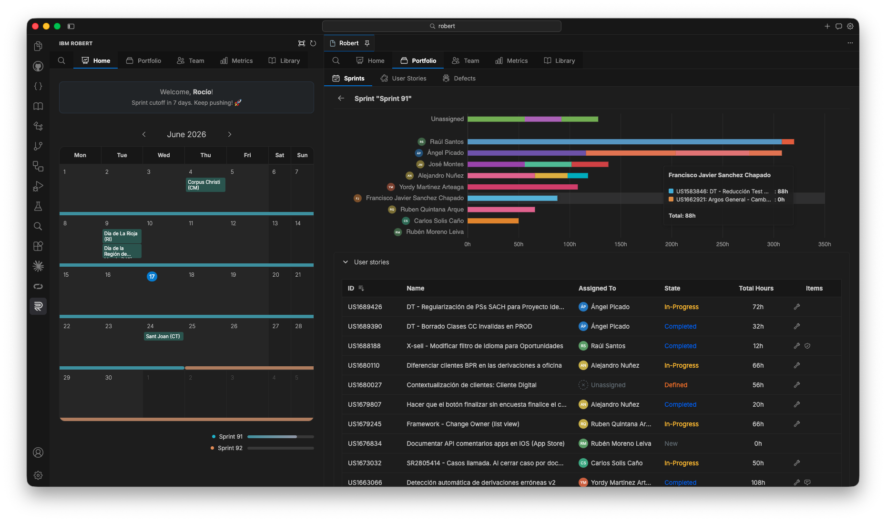
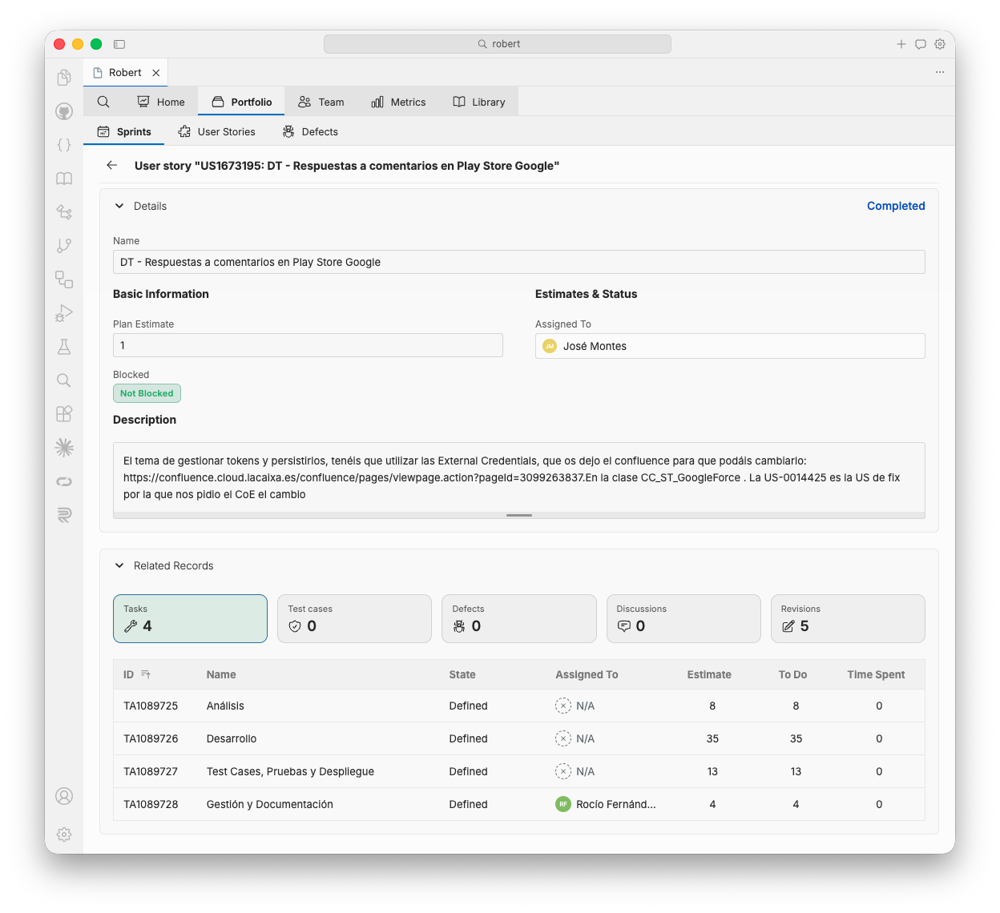
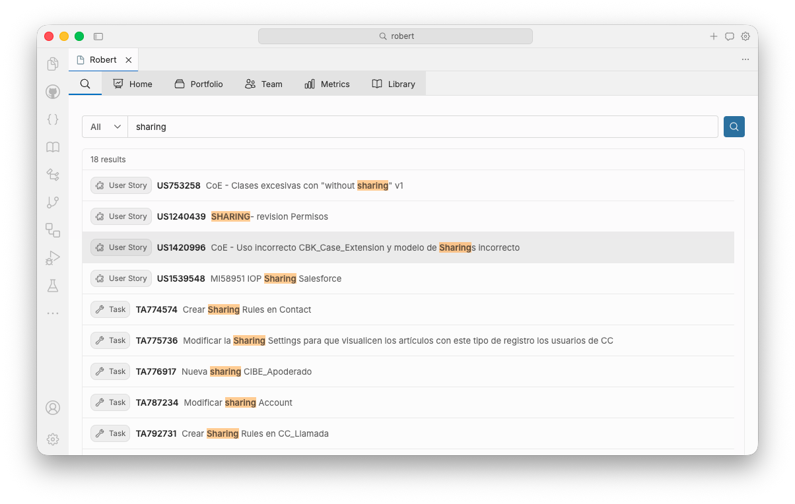
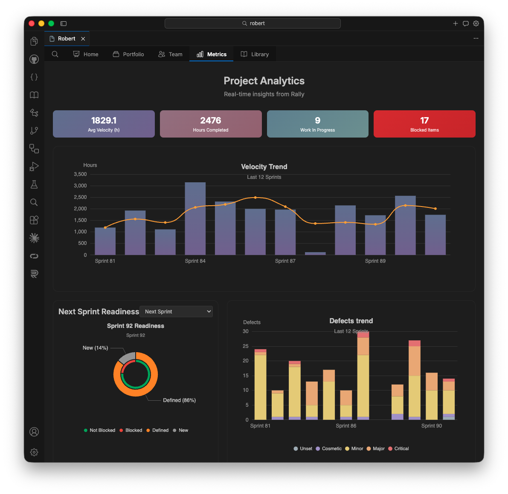

##  IBM Robert

**IBM Robert** brings Jira Cloud and Rally project management into your editor. Track sprints, user stories, defects, and team workload without leaving VS Code — with dashboards, search, and analytics built for day-to-day delivery work.

Robert comes in two flavours with the same features: a **VS Code extension** and a **standalone desktop app** for people who don't use VS Code (see [Standalone desktop app](#standalone-desktop-app)).

---

## What you can do with Robert

### Home — your sprint at a glance

The Home view welcomes you with a personalized dashboard: current sprint countdown, a monthly calendar with active sprints and regional holidays, and quick access to sprint details.



Open any sprint to see resource allocation per team member, user stories with state and hours, and a clear picture of who is working on what.

### Portfolio — user stories and defects

Browse work by sprint or across the full backlog. Open any user story to see its description, assignment, estimates, and related records — tasks, defects, discussions, and revisions — all in one place.



### Search — find anything fast

Search across user stories, tasks, and other Jira issues. Results are grouped by type, with keyword highlighting so you can jump straight to the item you need.



### Metrics — project analytics

The Metrics view provides real-time insights from Jira: velocity trends, hours completed, work in progress, blocked items, next-sprint readiness, and defect trends by severity over the last 12 sprints.



### Team

See each team member's progress for the current or past sprints — completed hours, total allocation, and linked user stories — to balance workload and spot bottlenecks early.

### Library

Access built-in tutorials and guides to get the most out of Robert and Jira workflows.

---

## Getting started

### Requirements

- Visual Studio Code 1.105.1 or later
- A Jira Cloud account with an API token
- Your Jira project key (e.g. `DSS`)

### Install

1. Install **IBM Robert** from the VS Code Extensions view, or install a `.vsix` package provided by your team.
2. Open the **IBM Robert** panel from the activity bar (left sidebar).
3. On first launch, configure your Jira connection (see below).

### Open Robert

- Click the **IBM Robert** icon in the activity bar, or
- Run **IBM Robert: Open Main View** from the Command Palette (`Cmd+Shift+P` / `Ctrl+Shift+P`).

You can also open Robert in a full editor tab via the **Open in Editor** button in the panel toolbar.

---

## Standalone desktop app

Robert is also available as a standalone desktop app (macOS, Windows, Linux) built from the same codebase as the extension. It offers the same views — Home, Portfolio, Team, Metrics, Search — in its own window.

- **Settings**: open **Settings…** from the app menu (`Cmd+,` / `Ctrl+,`). They are the same `robert.*` settings as in the extension. Settings you leave unset follow the `ROBERT_*` environment variables, then the defaults; **Reset** next to a setting goes back to that behaviour. API tokens are stored encrypted with your operating system's keychain (on Linux without a keyring, provide them through `ROBERT_JIRA_API_TOKEN` / `ROBERT_RALLY_API_KEY` instead).
- **Reload data**: **View → Reload Data** (`Cmd+R` / `Ctrl+R`).
- **Back / forward**: `Cmd+[` / `Cmd+]` on macOS, `Alt+←` / `Alt+→` on Windows and Linux, plus mouse side buttons and trackpad swipes.
- **Logs**: **View → Show Logs**.

To run it from source or build installers:

```bash
npm install
npm run standalone:start     # build and launch
npm run standalone:package   # installers for your OS in dist/standalone/
```

See [docs/STANDALONE.md](docs/STANDALONE.md) for details.

---

## Configuration

Connect Robert to your Jira Cloud site once; settings are saved across sessions.

1. Open VS Code Settings (`Cmd+,` / `Ctrl+,`).
2. Search for **Robert**.
3. Set:
   - **Jira Base URL** — e.g. `https://your-site.atlassian.net`
   - **Jira Email** — the email of your Atlassian account
   - **Jira API Token** — a token created at id.atlassian.com
   - **Jira Project Key** — the project you work on (e.g. `DSS`)

| Setting | Description |
|---------|-------------|
| Auto refresh | Keep data up to date automatically |
| Status bar sprint days | Show days left until sprint cutoff in the status bar |
| Welcome animation | Play the intro video on first open after reload |
| Collaboration | Optional real-time collaboration features (requires server URL) |
| Debug mode | Verbose logging to the Robert output channel |

---

## Navigation

Robert is organized around five main areas:

| Tab | Purpose |
|-----|---------|
| **Home** | Calendar, sprint overview, and sprint detail panels |
| **Portfolio** | User stories and defects by sprint or full list |
| **Team** | Per-member workload and progress |
| **Metrics** | Velocity, readiness, and defect analytics |
| **Library** | Tutorials and onboarding content |

Use the search icon in the top bar to find work items across the project.

---

## Tips

- **Reload data** — use the refresh button in the panel toolbar or run **IBM Robert: Reload**.
- **Status bar** — when enabled, shows how many days remain until the current sprint cutoff.
- **Output log** — if something looks wrong, open **View → Output → Robert** or run **IBM Robert: Show Robert Output**.

---

## Troubleshooting

| Issue | What to try |
|-------|-------------|
| Blank or empty view | Run **IBM Robert: Reload**, or restart VS Code |
| No data / connection errors | Check Jira base URL, email, API token, and project key in Settings |
| Stale information | Enable auto refresh, or use the reload button |
| Standalone app shows as "Electron" in the Dock | Launch it with `npm run standalone:start` / `standalone:dev` (not `electron` directly), or use a packaged build |
| Standalone app: no data | Open **Settings…** in the app menu and check the provider credentials; see **View → Show Logs** |

Enable **Debug mode** in Settings for more detail in the Robert output channel.

---

## License

See [LICENSE.md](LICENSE.md) for details.
